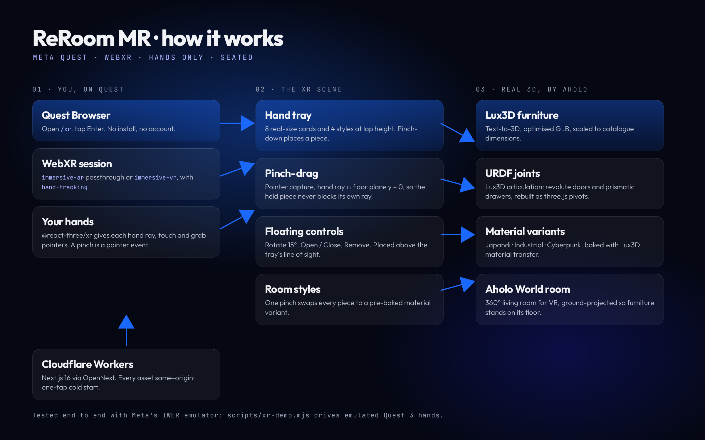

# Architecture

## Request path

1. The Quest Browser loads `/xr` (`src/app/xr/page.tsx`), a client page that checks `navigator.xr.isSessionSupported` and lazy-loads the scene.
2. **Enter mixed reality** calls `xrStore.enterAR()` (`immersive-ar`, passthrough, `hand-tracking`); **Enter VR** calls `enterVR()`.
3. `MRRoom` (`src/components/xr/MRRoom.tsx`) renders one React Three Fiber canvas inside `<XR>`. Everything after this happens on the device: there is no backend call in the XR flow.

## Components in `MRRoom.tsx`

| Component | Role |
|---|---|
| `xrStore` | `createXRStore`: hand input with ray, touch and grab pointers; controllers enabled; IWER emulator injected on `localhost` only |
| `Tray` / `TrayCard` | 8 furniture cards and 4 style buttons at lap height; pinch-down adds a piece |
| `Scene` | State: pieces, selection, style. `spawnSlot()` picks where a new piece lands |
| `PieceModel` | Loads the GLB (or style variant), `fit()` scales it to catalogue size, `useUrdf()` builds joints; pointer capture plus `floorPoint()` drives the drag |
| `PieceControls` | Rotate, Open / Close, Remove above the selected piece, at `controlsHeight()` |
| `RoomPanorama` | VR only: Aholo World 360° room via `GroundedSkybox`, floor at y = 0 |

Pure maths lives in `src/lib/xr.ts` so it is unit-tested without three.js.

## Assets

| Asset | Source | Path |
|---|---|---|
| 8 furniture GLBs (meshopt) | Aholo Lux3D text-to-3D | `public/library/*.glb` |
| Articulated parts + URDF | Lux3D articulation | `public/library/<id>/` |
| Style variants | Lux3D material transfer | listed in `content/manifest.json` |
| Thumbnails | rendered with `scripts/render-thumbs.mts` | `public/library/thumbs/` |
| 360° rooms | Aholo World | `public/rooms/*.jpg` |

## Hosting

Next.js 16 built with OpenNext and served by a Cloudflare Worker (`wrangler.jsonc`, worker `reroom-mr`). Static assets go through Workers Static Assets. The ReRoom web studio in the same app keeps its own server routes (`src/app/api/*`, Aholo key server-side only); the Quest flow does not use them.
