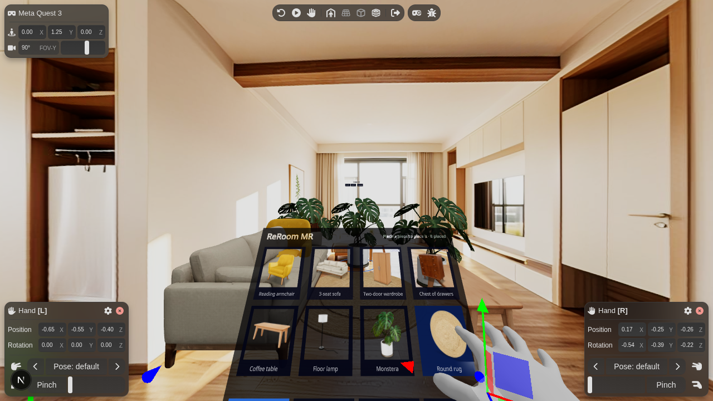
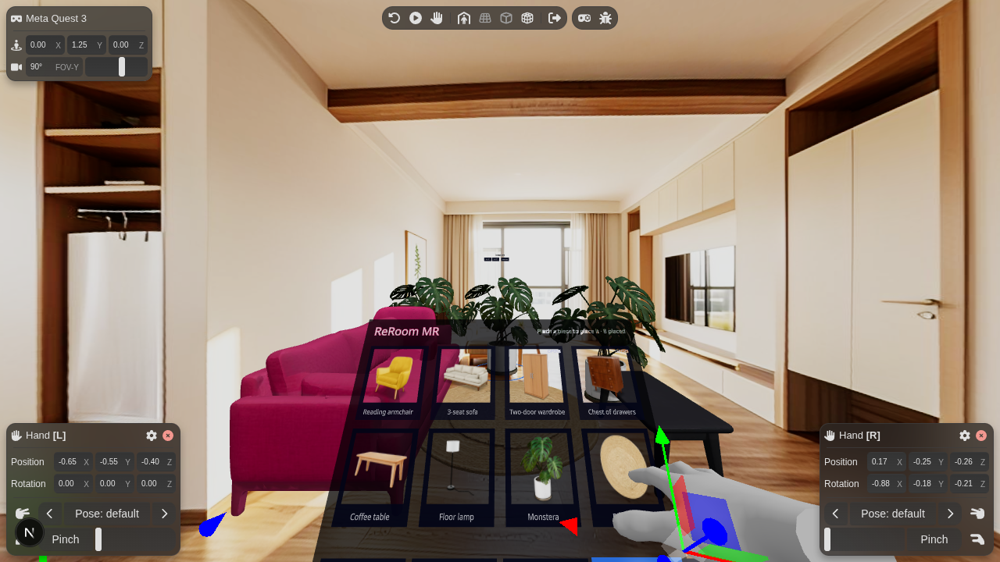
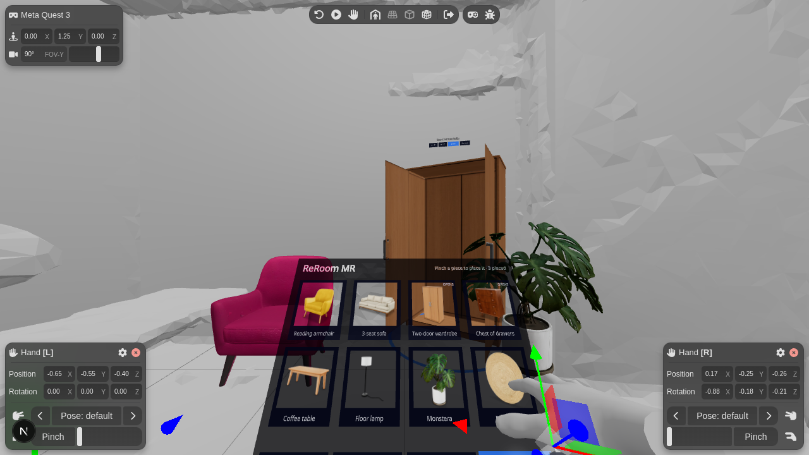
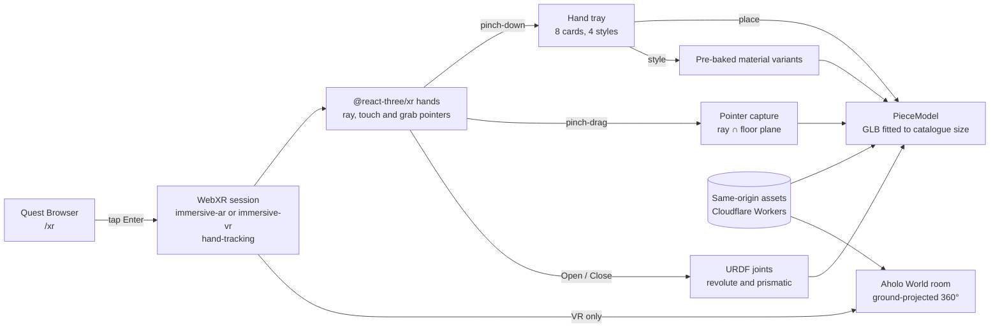
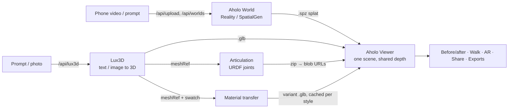

<p align="center">
  
</p>

<h1 align="center">ReRoom MR</h1>

<p align="center"><b>Furnish your real room with your hands.</b><br/>
A hands-first, seated mixed reality app for Meta Quest. Pinch real-size furniture onto your floor, drag it into place, open its doors and drawers, and restyle the whole room. No controllers, no install.</p>

<p align="center">
  <a href="https://reroom-mr.adoranto737.workers.dev/xr"></a>
  <br/>
  
  
  
  
  
  
  <a href="LICENSE"></a>
</p>

<p align="center">
  
</p>

<table>
<tr>
<td width="33%"><b>Track</b><br/>Productivity</td>
<td width="33%"><b>Division</b><br/>New Experience</td>
<td width="33%"><b>Device</b><br/>Meta Quest 3 / 3S · Quest Browser</td>
</tr>
</table>

**Try it:** on your Quest, open the Meta Quest Browser, go to **[reroom-mr.adoranto737.workers.dev/xr](https://reroom-mr.adoranto737.workers.dev/xr)** and tap **Enter mixed reality** to furnish the room you are sitting in, or **Enter VR** to furnish a real living room generated with Aholo World.

## The problem

Every empty room asks one question: *will it fit?* Today we answer it with a tape measure and a guess. We measure an alcove, scroll a catalogue on a flat screen, picture a 228 cm sofa against a 212 cm wall, and find out when the delivery arrives. A photo can't show scale, and a phone AR view is a small window you hold at arm's length.

## The answer: put the furniture in the room, at true size, with your hands

ReRoom MR runs in the Quest Browser. A small tray of real furniture floats at your lap. You pinch a piece and it stands on your floor at its true dimensions, through passthrough. You drag it to the wall with a pinch, turn it to face the TV, open the wardrobe to check the door clears the bed, and restyle the whole room in one pinch. You never stand up, and you never pick up a controller.

<table>
<tr>
<td></td>
<td></td>
</tr>
<tr>
<td align="center"><sub>VR: a real Aholo-generated living room, furnished and restyled</sub></td>
<td align="center"><sub>Mixed reality: wardrobe doors open on their real joints</sub></td>
</tr>
</table>

## Hands-first interactions

Everything works with bare hands. Controllers are supported too, never needed.

| Gesture | What it does |
|---|---|
| **Pinch a card** on the hand tray | Places that piece, at real size, on your floor about 2 m in front of you |
| **Pinch a piece** | Selects it (blue ring) and shows its floating controls |
| **Pinch and hold, then move your hand** | Drags the piece across the floor, following where your hand ray meets it |
| **Pinch ⟲ 15° / ⟳ 15°** | Turns the selected piece |
| **Pinch Open / Close** | Swings its doors or slides its drawers (wardrobe, chest of drawers: real URDF joints) |
| **Pinch a style** (Original, Japandi, Industrial, Cyberpunk) | Restyles every piece in the room at once |
| **Pinch Remove / Clear** | Removes the selected piece, or everything |

Design choices that came out of testing with the emulator's hands:
- Actions fire on **pinch-down**. A hand drifts while it lets go, so acting on release missed buttons.
- Dragging **captures the pointer** and intersects the hand ray with the floor plane, so the piece you are holding never blocks its own ray.
- Floating controls sit **above the tray's line of sight**, so aiming at a control never lands on a tray card.

## Seated and quick to start

- The tray rests at lap height, 55 cm ahead and tilted toward you: every card is within a seated reach.
- Furniture lands in a row about 2 m out. You never need to stand or turn around.
- Cold start is one page load and one tap: no install, no sign-in, no tutorial. The 8 pieces and 3 styles are pre-generated, compressed GLBs served from the same origin, so nothing waits on an AI call inside the headset.

## How it works



| Piece | Where |
|---|---|
| Entry page, support check, Enter MR / VR | `src/app/xr/page.tsx` |
| The XR scene: tray, pieces, drag, controls, URDF joints, styles, Aholo room | `src/components/xr/MRRoom.tsx` |
| Furniture catalogue (true dimensions) | `content/library.json` |
| Which pieces open, and their style variants | `content/manifest.json` |
| Models, articulated parts, variants, thumbnails | `public/library/` |
| 360° rooms generated with Aholo World | `public/rooms/` |
| Emulator test that drives the hands | `scripts/xr-demo.mjs` |

**Where the 3D comes from.** Every piece was generated with Aholo Lux3D (text-to-3D, then optimised). Its articulation step found the doors and drawers and wrote them as URDF; ReRoom MR rebuilds each joint as a pivot in three.js and animates it. Each style is a material variant baked ahead of time with Lux3D material transfer. The VR room is an Aholo World generation, projected onto a floor at y = 0 so furniture stands on it.

## Test it without a headset

`/xr` ships Meta's [Immersive Web Emulation Runtime](https://github.com/meta-quest/immersive-web-emulation-runtime) (IWER). On `localhost` it emulates a Quest 3 with hand tracking and a synthetic living room for passthrough.

```bash
pnpm install
pnpm dev --port 3200                                           # open http://localhost:3200/xr
node scripts/xr-demo.mjs http://localhost:3200 tmp/xr          # MR: place, select, drag, open, rotate, style, remove
node scripts/xr-demo.mjs http://localhost:3200 tmp/vr --vr     # VR: furnish the Aholo living room step by step
node scripts/xr-demo.mjs http://localhost:3200 tmp/vr --vr --video   # the same, recorded to .webm
pnpm test                                                      # self-checks (sizing, share links, guards)
```

`scripts/xr-demo.mjs` moves the emulated right hand from a seated rest pose, aims its ray at named targets, pinches, and checks the result of each step (pieces placed, moved, removed). It prints a timestamp for every step.

**Verified in the emulator:** pinch to place, select, pinch-drag across the floor, rotate, open the wardrobe doors, all four room styles, remove. **Not yet verified on a physical Quest.**

## Deploy

```bash
pnpm cf:deploy    # OpenNext build + wrangler deploy, worker "reroom-mr"
```

The Quest experience needs no API key: it only serves pre-generated assets.

## Roadmap

- Test and tune on a physical Quest 3 (tray height, pinch thresholds, passthrough lighting).
- Anchor furniture with WebXR plane detection and hit-test, so pieces snap to the real floor and walls.
- Bring the web studio's room scan into the headset: scan with a phone, walk the scanned room on Quest.
- Generate a new piece from a spoken description or a product photo, in the headset.
- Share a furnished room as a link others open on their own Quest.

---

ReRoom MR includes the ReRoom web studio it was built from: scan a room, remix it and restyle it in the browser. The rest of this README covers that.


## In one minute

Buying furniture is a guess. You measure, imagine, and hope it fits, and opens, and matches.

**ReRoom** turns the guess into a preview, built end to end on the **Aholo** platform by Manycore:

1. **Scan**: walk your room for a minute with your phone. **Aholo World · Reality** rebuilds it as a photoreal 3D Gaussian-splat room. No room handy? **SpatialGen** builds one from a sentence.
2. **Remix**: add pieces from a 24-model library, **describe** anything, or **snap a product photo**. **Lux3D** builds it with PBR materials at its real size.
3. **Open**: wardrobes swing, drawers slide, lids lift. **Lux3D articulation** finds the joints; ReRoom drives them in the browser.
4. **Restyle**: eight one-tap styles plus Style Roulette. **Lux3D material transfer** re-finishes every piece, or uses any material photo you give it.
5. **Live in it**: orbit, top-down, or walk at eye height; compare before and after; place a piece in your real room with **AR**; share a link; export **GLB, USDZ, STL, 3MF, OBJ or FBX**.

Every 3D object on the website, from the hero armchair to the icons, was generated with Aholo too.

## See it

<table>
  <tr>
    <td width="50%"></td>
    <td width="50%"></td>
  </tr>
  <tr>
    <td></td>
    <td></td>
  </tr>
  <tr>
    <td></td>
    <td></td>
  </tr>
  <tr>
    <td></td>
    <td></td>
  </tr>
</table>

### The studio

<p align="center"></p>

<table>
  <tr>
    <td width="50%"></td>
    <td width="50%"></td>
  </tr>
  <tr>
    <td></td>
    <td></td>
  </tr>
</table>

## How to use ReRoom

**Try it with no setup:** open the [sample loft in demo mode](https://reroom-mr.adoranto737.workers.dev/studio?room=industrial-loft&demo=1). Everything in the library works, nothing is generated, and nothing is saved anywhere but your browser.

| Step | What to do | What happens |
|---|---|---|
| **1. Pick a room** | Open a sample room from the landing page, or go to **Scan** and record a slow 30–60 s video (MP4/MOV, or Insta360 `.insv`). | Aholo Reality builds a 3D Gaussian-splat room in a few minutes. You can also type a sentence and SpatialGen builds a dream room. |
| **2. Add furniture** | In the left panel: **Library** (drag in any of 24 pieces), **Describe** (type a piece), or **Photo** (upload a product photo). | Lux3D generates a PBR model at its predicted real size. A ghost shows where it will land while it builds. |
| **3. Arrange** | Drag on the floor to move. `Q`/`E` rotate 15° (`Shift` for 5°), `Ctrl D` duplicates, `Del` removes, `Ctrl Z` undoes. Resize in the inspector. | Pieces stay on the floor and keep real dimensions. The room's walls hide furniture behind them. |
| **4. Open things** | Double-click a wardrobe, chest of drawers, sideboard, fridge or box. For anything you generated, press **Add moving parts**. | Lux3D articulation returns a URDF of links and joints; ReRoom animates the hinges and slides. |
| **5. Restyle** | Pick a style in the bar under the room, or **Roulette**. To use your own material, select a piece and choose **Material from a photo**. | Lux3D material transfer re-finishes each piece. Results are cached per piece and style, so switching back is instant. |
| **6. Look around** | **Orbit**, **Walk** (`W A S D`, drag to look) or **Top**. Change the light: day, evening, night. Open **Before / after**. | The before/after slider compares the empty and furnished room from the same camera, saved as a PNG. |
| **7. Take it with you** | Select a piece and choose **View in your room (AR)**, or export **GLB, USDZ, STL, 3MF, OBJ, FBX**. Press **Share** for a link or a 10-second tour video. | AR opens AR Quick Look on iPhone and Scene Viewer on Android at the size you set. Share links carry the whole design in the URL. |

## How deeply ReRoom uses Aholo

Ten Aholo capabilities, all called from the server with the key kept off the client.

| Aholo capability | SDK call | Where you see it in ReRoom |
|---|---|---|
| **World · Reality** | `world.reconstructions.create` | Phone or Insta360 video becomes a 3DGS room (`/scan`) |
| **World · SpatialGen** | `world.generations.create` | A sentence becomes a walkable room; all three sample rooms were made this way |
| **Aholo Viewer** | `@manycore/aholo-viewer` | The studio renderer: splat room and every GLB share one depth buffer, so walls hide furniture |
| **Lux3D text-to-3D** | `lux3d.textTo3d.create` | "Describe a piece", the 24-model library, the website's hero chair (G1) and clay icons |
| **Lux3D image-to-3D** | `lux3d.imgTo3d.create` | "Snap a photo" |
| **Lux3D articulation** | `lux3d.articulationAnimation.create` | Doors and drawers that open; returns a URDF that `Engine.loadUrdf` animates |
| **Lux3D material transfer** | `lux3d.materialTransfer.create` | Eight room styles, "material from a photo", the hero chair's leather, linen and bouclé |
| **Lux3D part split** | `lux3d.partSplit.create` | The hero chair flying apart on the landing page (server API for the studio) |
| **Lux3D multi-format export** | `lux3d.multiFormatExport.create` | USDZ for AR, STL and 3MF for 3D printing, OBJ and FBX for DCC tools |
| **Asset API** | `asset.uploadBuffer` | Uploads scans, photos, library models and material references |

**Measured usage** during development, from `lux3d.tasks.list` (`consumedCredits` per task):

| Lux3D task | Tasks | Succeeded | Credits |
|---|---:|---:|---:|
| text-to-3D | 41 | 41 | 540 |
| material transfer | 64 | 63 | 441 |
| articulation | 8 | 8 | 224 |
| part split | 6 | 6 | 180 |
| multi-format export | 3 | 2 | 2 |
| image-to-3D | 1 | 1 | 1 |
| API exploration (multimodal-to-image, four-view, multi-image-to-3D) | 15 | 15 | 200 |
| **Total** | **138** | **136** | **1,588** |

Plus Aholo World: three SpatialGen rooms and one Reality reconstruction attempt. Verified method names, parameters, outputs and per-call costs are in [`reroom-docs/api-notes.md`](reroom-docs/api-notes.md).



## Everything we generated with Aholo

All of it lives in this repo, is browsable on the landing page's **Made with Aholo** gallery, and is listed with prompts on [`/made-with-aholo`](https://reroom-mr.adoranto737.workers.dev/made-with-aholo).


| Asset set | Count | Aholo capability | Where |
|---|---:|---|---|
| Furniture library | 24 | Lux3D text-to-3D | `public/library/*.glb` |
| Articulated pieces (URDF) | 7 | Lux3D articulation | `public/library/L_*/robot.urdf` |
| Restyled finishes | 33 | Lux3D material transfer | `public/library/variants/` |
| Dream rooms | 3 | World SpatialGen | `public/rooms/*.spz` |
| Hero chair (G1) + 3 finishes + parts + USDZ | 6 | text-to-3D, material transfer, part split, export | `public/site/hero/`, `public/site/ar/` |
| Clay icons | 6 | Lux3D text-to-3D (cartoon) | `public/site/icons/` |

## The website

The landing page is a scroll story in an **ink, paper and ultramarine** system: Outfit and JetBrains Mono, liquid-glass buttons whose highlight follows the cursor, chrome type, torn-paper sheets that tear apart as you scroll, and photos that tear open into view.

- **The 3D chair** is one fixed, transparent React Three Fiber canvas between section backgrounds and text. It travels a Catmull-Rom path through per-section keyframes ([`src/landing/heroKeyframes.ts`](src/landing/heroKeyframes.ts)), trails the scroll with inertia, floats, banks and leans toward the cursor. Each section has its own effect: particle dissolve, wireframe room, part-split explode, four finishes synced with the chips, a landing on the phone screen, and a room corner whose lamp switches on.
- **Performance:** the canvas mounts after first paint behind a poster rendered from the same chair, pixel ratio is capped at 1.75, rendering pauses in hidden tabs, and `prefers-reduced-motion` switches to fades between still poses.
- **Motion:** GSAP for the hero intro, torn sheets, blur-in reveals, paper-cut photo reveals, magnetic buttons, count-ups and the self-drawing step line ([`src/components/landing/Motion.tsx`](src/components/landing/Motion.tsx)).
- **The studio** uses the same tokens in a dark theme (`.studio-dark`), so the dashboard and the site read as one product.

## Status

Honest state of the web studio (18 November 2026):

| | Feature | How it was verified |
|---|---|---|
| ✅ | Aholo Viewer renders splat rooms and Lux3D GLBs in one depth buffer | Furniture is correctly occluded by the splat floor |
| ✅ | SpatialGen dream rooms | 3 rooms generated and shipped as samples |
| ✅ | Text → 3D, photo → 3D | Live runs through `/api/lux3d`, loaded in the studio via the proxy |
| ✅ | Articulation | All 7 seed pieces plus a live-generated cabinet |
| ✅ | Material transfer restyle | Pre-baked variants for 3 styles, a live restyle, material from a photo (API), the hero chair finishes |
| ✅ | Multi-format export, AR page | USDZ and STL returned; `/ar` renders at the studio size (desktop; not yet on a phone) |
| ✅ | Editor interactions | Driven with real pointer and keyboard events in Playwright |
| ✅ | Landing page 3D hero | Playwright walk of every section at 1440 px and 390 px |
| ✅ | Cloudflare deploy | Live on Workers (OpenNext); live restyle, proxy and a 55 MB upload tested on the deployed site |
| ✅ | Demo mode spends nothing | A file set on a hidden input in demo mode makes 0 `/api/lux3d` requests (tested live) |
| ⚠️ | Reality reconstruction from a phone video | Wired end to end; a synthetic test video was rejected. A real 30–60 s walkthrough is still needed |
| ⚠️ | Scan upload size | 60 MB on Workers (memory-bound), 500 MB locally |
| ⚠️ | Live results | Aholo result URLs expire after about 2 h; the seed library is stored in the repo |
| ⚠️ | Real-GPU frame rate | Measured only in headless Chromium |
| ⏳ | Part split editing UI | API route only |

## Quick start

Requirements: Node 22+, pnpm, and an Aholo **Global** API key from [labs.aholo3d.com](https://labs.aholo3d.com/api-keys).

```bash
pnpm install                 # also patches Aholo Viewer worker URLs (scripts/patch-viewer.mjs)
cp .env.example .env.local   # then set AHOLO_API_KEY (server-only, never commit it)
pnpm dev                     # http://localhost:3000
```

Open `/studio?room=industrial-loft`, or add `&demo=1` for demo mode with no live Aholo calls.

### Deploy to Cloudflare Workers

```bash
npx wrangler login
npx wrangler kv namespace create REROOM_BUDGET   # put the id in wrangler.jsonc
pnpm cf:deploy                                   # OpenNext build + wrangler deploy
npx wrangler secret put AHOLO_API_KEY            # once, and again whenever you rotate the key
```

`pnpm cf:preview` runs the same build locally in workerd. The build strips `.env.local` values from the Worker bundle (`scripts/cf-strip-env.mjs`); the key only lives in the Worker secret. Credit protection on the deployed site: per-IP and site-wide rate-limit bindings, a per-isolate window, and a daily task budget in KV (`DAILY_TASK_BUDGET`).

### Scripts

| Command | What it does |
|---|---|
| `pnpm seed [ids…]` | Generates the furniture library with Lux3D (text-to-3D → optimize → articulation → URDF). Resumable |
| `tsx --env-file=.env.local scripts/gen-site-assets.mts hero icons` | Generates the website's assets from `content/site-assets.json` (resumable; `--reroll ID --prompt "…"`) |
| `tsx --env-file=.env.local scripts/bake-variants.mts japandi L_SOFA_3 …` | Pre-bakes style variants with material transfer |
| `tsx --env-file=.env.local scripts/gen-world.mts "<prompt>"` | Starts a SpatialGen dream room |
| `node --experimental-strip-types scripts/render-thumbs.mts [url] [group]` | Transparent product renders of every model (model-viewer in headless Chromium) |
| `node --experimental-strip-types scripts/capture.mts [url] [dir] [w] [h] [dpr]` | One screenshot per landing section, plus FPS and console errors |
| `node --experimental-strip-types scripts/record-readme.mts [url]` | Records the README GIFs and screenshots (demo mode, never spends credits) |
| `pnpm test` | Self-checks: prompt guard, proxy allowlist, output picking, sizing, share links |

### Environment

| Variable | Where | Purpose |
|---|---|---|
| `AHOLO_API_KEY` | server | Aholo Global key |
| `AHOLO_REGION` | server | `com` (Global) or `cn` |
| `SITE_URL` | build | Public origin, used for OpenGraph URLs |
| `DAILY_TASK_BUDGET` | server (Workers) | Lux3D + World tasks allowed per UTC day on the deployed site (default 300) |
| `NEXT_PUBLIC_UPLOAD_MAX_MB` | build | Scan upload cap (500 locally, 60 on Workers) |

## Project structure

```
src/
  app/                   landing, /studio, /scan, /view (shared), /ar, /made-with-aholo, privacy, terms
  app/api/               lux3d, worlds, upload, proxy, status
  components/landing/    ScrollHero (R3F), Motion (GSAP), AssetGallery, Shot
  components/studio/     Viewport, AddPanel, Inspector, StyleBar, BeforeAfter, ShareDialog…
  landing/               heroKeyframes.ts (tune the chair per section), heroStore
  lib/aholo/             server.ts: the only module that calls Aholo
  lib/viewer/            engine.ts: the only module that calls the Aholo Viewer
content/                 library, styles, rooms, manifest, site-assets (+ lock)
public/library/          24 Lux3D models, 7 URDF articulations, 33 variants, renders
public/site/             hero chair set, clay icons, AR USDZ
public/rooms/            3 SpatialGen rooms (.spz + panorama)
scripts/                 seed, bake, world, site assets, renders, capture, README recording
```

## Credits

- Built on [Aholo](https://www.aholo.ai) by Manycore: Lux3D, World and the [Aholo Viewer](https://github.com/manycoretech/aholo-viewer) (MIT). The Aholo wordmark in `public/brand/` is a trademark of Manycore, used to credit the platform.
- `src/lib/viewer/camera-control.ts` is adapted from the Aholo Viewer website (MIT).
- Material reference swatches from [ambientCG](https://ambientcg.com) (CC0), listed in `public/materials/CREDITS.txt`.
- Three material reference photos in `content/stock-refs/` are licensed from Adobe Stock; they are **not** covered by the MIT license (see the `LICENSE.txt` there), are not served by the site, and are used only as Lux3D inputs.
- AR via [`<model-viewer>`](https://modelviewer.dev) (Apache-2.0). 3D on the landing page with [React Three Fiber](https://r3f.docs.pmnd.rs) and [drei](https://github.com/pmndrs/drei); motion with [GSAP](https://gsap.com).
- Every furniture model, room, finish and icon in this repo was generated with Aholo Lux3D and Aholo World.

## License

[MIT](LICENSE)
